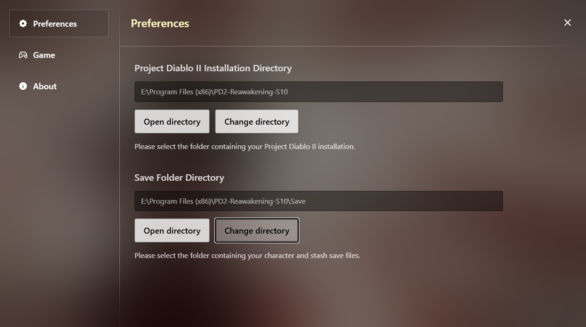

# PD2 SP Reawakening

Originally I just wanted to add some items to the game from 1.08, but after lurking in r/projectdiablo2 and the pd2’s #feedback channel I decided to implement a bunch of things that I either agreed with or just straight up thought would be fun.

Comments and feedback would be very appreciated, join the [Discord](https://discord.gg/rBCNMWaCNt) and share your thoughts!

Forked from the original sp mod [PD2 SP Plus](https://github.com/Lukaszpg/PD2-Single-Player-Plus-mod)

**Current version: v14.0.3 Alliance**, built on PD2 Season 14 (Alliance).

**[Discord](https://discord.gg/rBCNMWaCNt) | [Wiki](https://pd2reawakening.com/wiki/)**

## New Features

- **Awakening**: A new system similar to corruption. Equipment and unique charms can be awakened when cubed with a Vial of Awakening, awakening it with a new property.
- **Fate Cards:** Stackable uncommon drops, that upon collecting a certain amount, can be cubed together in exchange for a reward. Similar to Path of Exile’s [divination cards](https://pathofexile.fandom.com/wiki/Divination_card).
- **Legacy Items**: Obtained through a rare drop Relic of the Nephalem, these legacy items are extremely powerful items from Diablo 2 LoD patch 1.08.
- **Replica Items**: Reproductions of existing items that come with a twist.
- **New Orbs**:
  - _Ancient Orb_: Transforms Rare item to Unique (excluding charms)
  - _Regal Orb_: Transforms Rare item to Set
  - _Divine Orb_: Rerolls unique item, limited to: equipment, jewelry, grand charms
  - _Orb of Unmaking_: Allows an item to be Awakened once more, keeping existing properties intact.
  - _Tainted Jeweller's Orb_: Unpredictably unsockets an item, either keeping or destroying contents in the process.
  - _Coin_: Gold sink purchasable from Akara
- **Item Changes**: Introducing new uniques, new runewords, and updating old ones to bring them back into play
- **New Cube Recipes**: +2 class skill Circlet crafting, rune downgrading, and more.
- **Drop Rate Increases**:
  - Rune drops increased by 500%
  - Drop rates increased across the board, see TreasureClassEx.txt for specifics or see [this](https://docs.google.com/spreadsheets/d/e/2PACX-1vSmG2BYE-c6W7l0ha8OcyEQROgDSKFtR99mWHuT9XM6OXW_f4ym87x-d5GrhlO37msQqxt2IJj_XRbF/pubhtml) for a short comparison


## Installation

If you've played PlugY or any other PD2 single player mod, your current characters/stash will likely be incompatible.

**Upgrading from v11:** v14 moved Reawakening's item stats to new stat ids to fit Season 14, so items saved by v11 (awakened items especially) will not load correctly. Start v14 in a new save folder (see [Changing Save Folder Path](#changing-save-folder-path)).

#### With Launcher (auto-updates Reawakening)

1. Create a copy of your PD2 installation in a new directory.
1. Install [PD2-PlugY](https://github.com/synpoox/PD2-PlugY)
1. Download and Install the [Latest Release](https://github.com/synpoox/pd2-ra-launcher/releases/latest) of [PD2 RA Launcher](https://github.com/synpoox/pd2-ra-launcher)
1. Run `pd2-ra-launcher.exe`
1. Set your `Project Diablo II Installation Directory` in the Settings by clicking the cog-wheel in the top right.
1. Click `Play`.
1. Go to Akara and look for an item with Alkor's quest potion. If it's there and reads `v14.0.3 Alliance`, then the mod was installed successfully.

#### Manual Install (No auto-updates)

1. Create a copy of your PD2 installation in a new directory.
1. Install [PD2-PlugY](https://github.com/synpoox/PD2-PlugY)
1. Go to [Releases](https://github.com/synpoox/pd2-reawakening/releases) and download the latest `pd2data.mpq` and `BH.dll`
1. Copy and paste `pd2data.mpq` and `BH.dll` into your new PD2-PlugY install, overwriting any old files.
1. Launch the game with `Plugy.exe`
1. Go to Akara and look for an item with Alkor's quest potion. If it's there and reads `v14.0.3 Alliance`, then the mod was installed successfully.

## Changing Save Folder Path

Following the above instructions will point your new PD2 Reawakening install at your old PD2 save folders, which can cause errors with incompatible characters/stashes. To change your save folder path:

#### With Launcher
1. Click the `Settings` cog-wheel in the top right
1. In `Preferences`, under Save Folder Directory, click `Change directory`
1. Select your desired Save directory



#### Without Launcher

1. Open `ProjectDiablo.json` in your new `...\PD2-Reawakening\ProjectD2` folder
1. Look for `"save_path"` and edit it to your chosen directory:

```JSON
"other": {
  "lng_file": "",
  "installpath": "C:\\Program Files (x86)\\PD2-Reawakening\\",
  "save_path": "C:\\Program Files (x86)\\PD2-Reawakening\\Save\\"
}
```
**Note that double backslashes are required**

## Adding new orbs/cards to your filter

This contains the new misc item types (fate cards, new orbs, relics), stylized for Kryszard's filter.

1. In-game, set a hotkey for `Reload Loot Filter` and press it
1. Find and open the file that gets displayed in game
1. Paste the following somewhere near the top
```
//PD2 Single Player Reawakening
ItemDisplay[awst OR mfo OR exo OR dvo OR rgo OR cho OR tjo OR dvia]: %BORDER-0A%%DOT-62%%GREEN%*%PURPLE%*%RED%*       %NAME%       %RED%*%PURPLE%*%GREEN%*
//all cards
ItemDisplay[CARD]: %BORDER-0A%%DOT-62%*%PURPLE%      %NAME%          
//relics, orb of unmaking, prime evil embers
ItemDisplay[rotf OR rotv OR rofp OR oou OR teo OR heo OR deo]: %BORDER-68%%ORANGE%pick %PURPLE%*%RED%*%YELLOW%*%GREEN%*     %NAME%     %GREEN%*%YELLOW%*%RED%*%PURPLE%* %ORANGE%up
```

## Building a release

GitHub Actions builds everything; nothing is built by hand.

1. Edit the tables in `data/global/excel/`. Keep CRLF line endings and trailing tabs (edit with a D2-aware tool or a script).
1. Launch the game once with `-direct -txt` so it recompiles the `.bin` files, and copy the `.bin` files it wrote back into `data/global/excel/`. In MPQ mode the game reads only the `.bin` files, and the build fails if one is missing or its record count differs from the `.txt`.
1. Commit and push. CI builds `pd2data.mpq`, the 1/2/3/5/10x density variants and `manifest.json` (download them from the run's `dist` artifact to test). Density multiplies the MonDen, MonUMin and MonUMax columns of `Levels.txt`/`levels.bin`; unique-pack counts cap at 255 because the game stores them in one byte.
1. For a new version, update the version item's text: `pdreDesc` in `data/local/LNG/ENG/patchstring.tbl`, and `TBL_EDITS` in `tools/resolutions.py` so a rerun of the merge keeps it.
1. Tag and push to publish: `git tag v14.0.3 && git push origin v14.0.3`. The launcher picks up the release's `manifest.json`.

`BH.dll` is built from the [synpoox/BH](https://github.com/synpoox/BH) fork (branch `s14-upstream`: upstream PD2 BH plus Reawakening's awaken indicators and `CARD` filter keyword). BH hardcodes some of Reawakening's stat and item type ids (`STAT_AWAKENED`, `STAT_AWAKENER`, `STAT_SKILLONEQUIP_DISPLAY`, `ITEM_TYPE_CARD` in `BH/Constants.h`); if a merge moves them, update those and rebuild.

### Moving to a new PD2 season

Reawakening's tables are merged onto each new PD2 season with a three-way merge (`tools/merge3.py`, `tools/merge_tbl.py`), using the vanilla PD2 data Reawakening was last built on as the base. Decisions on conflicting cells live in `tools/resolutions.py`. How the S14 Alliance merge was done, and every conflict it resolved, is in [docs/s14-merge](docs/s14-merge/README.md).
